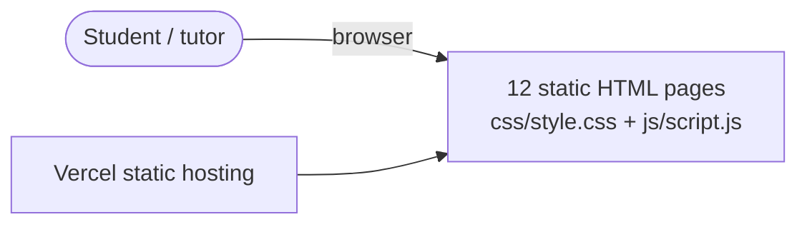
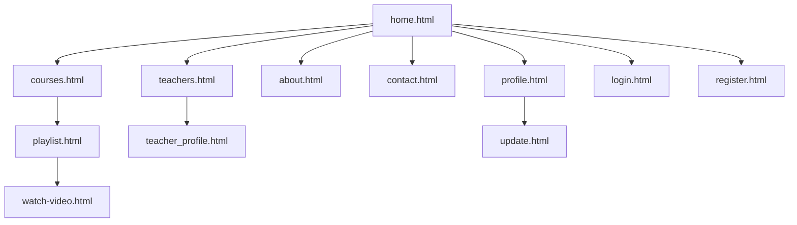

# EduHub: High-Level Design

A responsive e-learning website front end: home, courses, video playlists, watch page, teachers and tutor profiles, student profile, login, register and contact pages, with dark mode. Live at [edu-hub-tb.vercel.app](https://edu-hub-tb.vercel.app). For code-level detail see the [Low-Level Design](lld.md).

## 1. Context

The site is a front-end template: there is no backend, so login, register, profile update and comments are UI only.

## 2. Pages

## 3. Tech

| Item | Choice |
|---|---|
| Markup / style | HTML5, one shared stylesheet |
| Behavior | Vanilla JavaScript (`js/script.js`) |
| Icons | Font Awesome |
| Hosting | Vercel |
