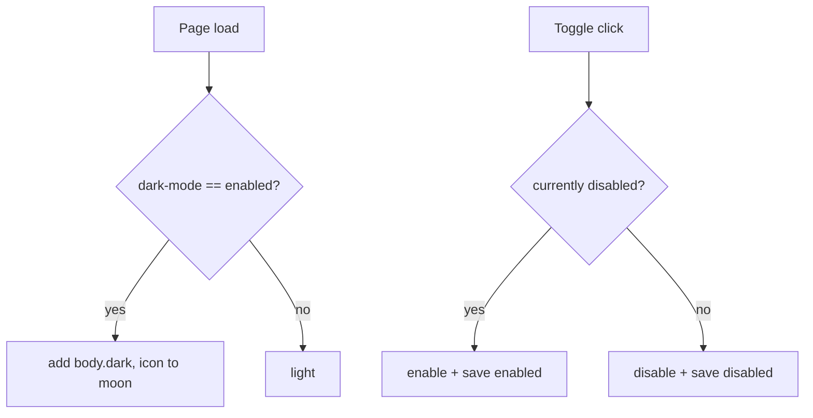

# EduHub: Low-Level Design

For the big picture see the [High-Level Design](hld.md).

## 1. Shared layout

Every page has the same header (logo, search form, dark-mode toggle, user button with profile dropdown) and side bar (profile summary and navigation), so `js/script.js` works on all pages.

## 2. Script behavior

| Element | Behavior |
|---|---|
| `#toggle-btn` | Switches dark mode; saved in `localStorage['dark-mode']` as `enabled` / `disabled` and restored on load |
| `#user-btn` | Toggles the profile dropdown, closes search |
| `#search-btn` | Toggles the search form (mobile), closes the profile |
| `#menu-btn` / `#close-btn` | Opens / closes the side bar |
| `window.onscroll` | Closes profile and search; closes the side bar below 1200 px width |

## 3. Dark mode

## 4. Notes

The header search forms submit to `search.html`, which is not in the repo, and the login / register / update forms have no backend. Adding a search page and an API (or a service like Firebase) would make them functional.
